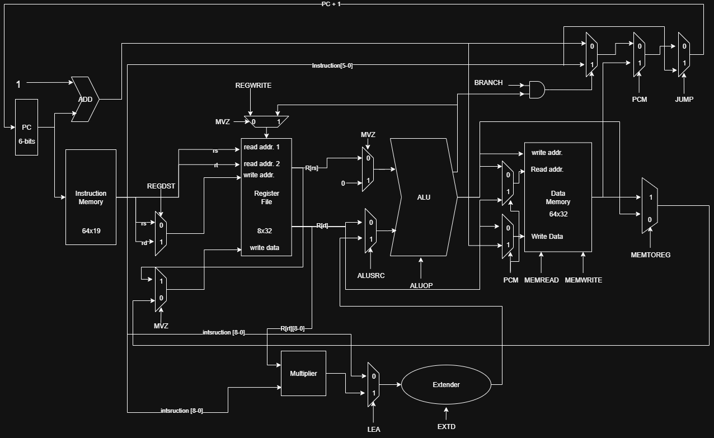
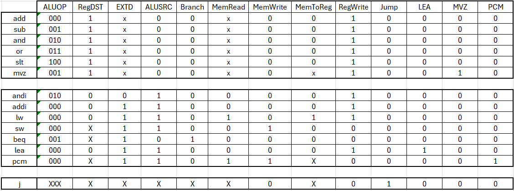
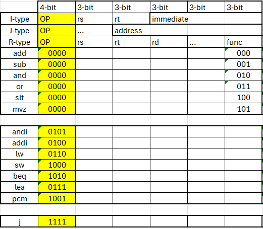

# Single-Cycle MIPS Processor (VHDL Implementation)

This project implements a simplified **single-cycle MIPS processor** in **VHDL** that supports a selected subset of MIPS instructions along with **three custom instructions**: `lea`, `mvz`, and `pcm`.

The processor is follows a single-cycle execution model, where each instruction is fetched, decoded, executed, and completed within one clock cycle.

---
## Instruction Formats
| Format  | 4-bits | 3-bits | 3-bits | 3-bits       | 3-bits       | 3-bits |
|---------|--------|--------|--------|--------------|--------------|--------|
| I-type  | `op`   | `rs`   | `rt`   |               `immediate (9-bits)`   |
| J-type  | `op`   | —      |                    `address (12-bits)`        |
| R-type  | `op`   | `rs`   | `rt`   | `rd`         |  —           | `func` |

## Supported Instruction Set

###  Arithmetic & Logic Instructions
| Instruction | Operation                          |
|-------------|-------------------------------------|
| `add`       | `R[rd] = R[rs] + R[rt]`            |
| `sub`       | `R[rd] = R[rs] - R[rt]`            |
| `and`       | `R[rd] = R[rs] & R[rt]`            |
| `or`        | `R[rd] = R[rs] \| R[rt]`            |
| `addi`      | `R[rt] = R[rs] + Imm`              |
| `andi`      | `R[rt] = R[rs] & Imm`              |
| `slt`       | `R[rd] = (R[rs] < R[rt]) ? 1 : 0`   |

### Memory Instructions
| Instruction | Operation                           |
|-------------|--------------------------------------|
| `lw`        | `R[rt] = Memory[R[rs] + offset]`    |
| `sw`        | `Memory[R[rs] + offset] = R[rt]`    |

### Control Flow Instructions
| Instruction | Operation                          |
|-------------|-------------------------------------|
| `beq`       | `if (R[rs] == R[rt]) PC += offset` |
| `j`         | `PC = address`                     |

---

## Custom Instruction Set

###  `lea rs, rt, K`
```mips
# R[rt] = K * LSB9(R[rt]) + R[rs]
# Description:
# Multiply the least significant 9 bits of register R[rt] by constant(immediate) K,
# then add the result to the content of R[rs] and store the final value in R[rt].
```

###  `mvz rd, rs, rt`
```mips
# if (R[rt] == 0) R[rd] = R[rs]
# Description:
# Move the content of register R[rs] to R[rd] only if the value in R[rt] is zero.
```

###  `pcm (rt), offset(rs)`
```mips
# PC = Memory[R[rt]]
# Memory[R[rs] + offset] = PC + 1
# Description:
# Load the PC with the value stored in memory at address R[rt],
# then write PC + 1 to memory at address R[rs] + offset.
```
## Datapath Diagram


## Control Signals


## instruction code


## Test Cases
written a set of 11 test cases to ensure the correct functionality of the processor, they mostly test happy scenarios.

    Instruction 0: ADD r2, r3, r1   ; r1 = r2 + r3 = 10 + 5 = 15
    ADD  $r1, $r2, $r3

    Instruction 1: SUB r4, r5, r6   ; r6 = r4 - r5 = 20 - 5 = 15
    SUB  $r6, $r4, $r5

    Instruction 2: ADDI r1, r2, 7   ; r2 = r1 + 7 = 15 + 7 = 22
    ADDI $r2, $r1, 7

    Instruction 3: ANDI r2, r3, 0xF ; r3 = r2 & 0xF = 22 & 15 = 6
    ANDI $r3, $r2, 0xF

    Instruction 4: LW r4, 8(r5)     ; r4 = Mem[r5 + 8] = Mem[13] = 99
    LW   $r4, 8($r5)

    Instruction 5: SW r4, 8(r1)     ; Mem[r1 + 8] = r4 → Mem[23] = 99
    SW   $r4, 8($r1)

    Instruction 6: BEQ r2, r3, label ; if r2 == r3, branch
    BEQ  $r2, $r3, label

    Instruction 7: NOP              ; no operation
    NOP

    Instruction 8: LEA r2, r5, r2, 5 ; r2 = r5 + r2*5 = 680 (custom instr.)
    LEA  $r2, $r5, $r2, 5

    Instruction 9: MVZ r3, r1, r2   ; if r2 == 0, r3 = r1 (custom instr.)
    MVZ  $r3, $r1, $r2

    Instruction 10: PCM r3, r7, 4   ; Mem[4] = r3 + r7 = 11 (custom instr.)
    PCM  $r3, $r7, 4

    Instruction 11: JUMP 11         ; jump to instruction index 11
    J    11
